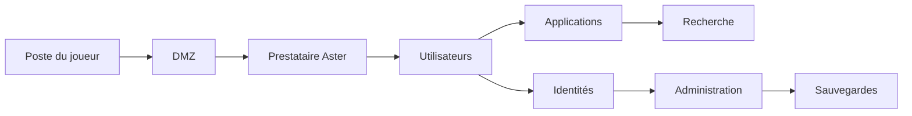

# Acte III : Les frontières invisibles

**Vision et inspirations.** Les douze missions sont désormais jouables. Les
six dernières déclarent 38 machines et huit segments, avec second pivot et
profils de protection. Ce document conserve la vision plus large ; la
[couverture livrée](ACTE_III_COUVERTURE.md) distingue les mécanismes présents,
les systèmes secondaires et la persistance intermissions encore absente.

## Intention et fil rouge

Le groupe fictif Lenoir prépare une opération industrielle avec Orme. Spectre
commande un accès vérifié à un dossier commercial précis. Le prestataire Aster
maintient une partie du système d'information ; ses anciens comptes, ses outils
et ses habitudes ont survécu à plusieurs changements de contrat.

Le joueur commence avec une adresse et une passation incomplète, pas une carte
exhaustive ni un compte administrateur universel. Il construit deux cartes :
les chemins réseau réellement joignables et les droits effectivement obtenus.
Une nouvelle session ne résout pas automatiquement la seconde frontière.

Madame_TLS comprend les sociétés, leurs partenaires et l'intérêt économique du
dossier. Elle aide à distinguer une publication commerciale d'une information
interne et demande progressivement plus que le périmètre initial. Elle ne donne
pas les paramètres d'un tunnel ou un correctif magique pour Defender. Traverse
porte le réseau, Iris les identités, Cendre les versions, Quartz les passations.
Les autres liens restent professionnels ou amicaux ; seule Madame_TLS peut
mener à l'attirance. Aucun lien affectif n'accorde un droit sur une pièce privée.

## Infrastructure proposée

Deux domaines : `lenoir.lab` pour le client, `aster.lab` pour le prestataire.
Ils n'accordent pas de droits d'administration réciproques par défaut.

| Segment | Plage fictive | Machines | Fonction et frontière |
|---|---|---:|---|
| DMZ | 10.90.10.0/24 | 4 | Portail prestataires, frontal, passerelle de maintenance, relais de dépôt |
| Utilisateurs | 10.90.20.0/24 | 6 | Achats, finance, assistance, IT, sécurité et poste externe |
| Identités | 10.90.30.0/24 | 4 | Deux contrôleurs de domaine, PKI et fournisseur d'identité |
| Applications | 10.90.40.0/24 | 6 | ERP web et base, documents, portail interne, archives, API partenaires |
| Prestataire Aster | 10.91.10.0/24 | 4 | Bastion Linux, SFTP, serveur de maintenance Windows, dépôt de documentation |
| Recherche | 10.92.10.0/24 | 5 | PLM, partage CAO, build, poste ingénieur et serveur de projets |
| Administration | 10.90.60.0/24 | 5 | Bastion renforcé, orchestration, console de sécurité, correctifs, services d'administration |
| Sauvegardes | 10.90.70.0/24 | 4 | Console, proxy de sauvegarde, dépôt et restauration de test |
| **Total** | **8 segments** | **38** | Un seul monde persistant, découvert progressivement |

La PKI et le fournisseur d'identité donnent du contexte et des contrôles réels ;
ils n'imposent pas une nouvelle famille d'exploitation sans outils correspondants.
La copie hors ligne des sauvegardes est un état/document séparé, pas une machine
prétendument scannable. L'atelier industriel reste un contexte métier, sans ajouter
un contrôle de procédés à cet acte.



Ce graphe exprime des frontières de conception, pas des routes ouvertes. Chaque
flèche doit devenir une matrice de flux avec source, destination, protocole,
port, authentification, résolution DNS et état de la règle. Certains flux seront
unidirectionnels ; d'autres ne seront ouverts que depuis un bastion précis.

## Contrat de reconnaissance

Nmap reste utilisable pour poser une hypothèse et vérifier un service. Il ne
révèle pas une zone simplement parce qu'elle existe dans le scénario.

- Séparer la découverte d'hôtes, le filtrage des ports, l'absence de route,
  l'arrêt d'un service et l'isolement décidé par le défenseur.
- `-Pn` saute la découverte préalable. Il ne débloque aucun flux. Une cible peut
  alors présenter des ports filtrés. Bloquer seulement ICMP ne garantit pas
  que toute découverte échoue : les sondes par défaut ne sont pas toutes ICMP.
- Pour le premier cas pédagogique, les sondes de découverte usuelles sont
  filtrées, mais le service utile reste joignable depuis la bonne origine.
- Comparer les résultats depuis Kali, un relais Linux et une session Windows.
  Une route ou un proxy appartient au contexte qui l'utilise.
- Une énumération TCP via SOCKS n'est pas un scan de paquets bruts. ProxyChains-NG
  ne transporte pas ICMP ou UDP ; refuser proprement les combinaisons impossibles.

Exemples de syntaxes cibles à reproduire et qualifier dans le simulateur :

```text
nmap -sV -p 5985,5986 10.90.20.21
nmap -Pn -sV -p 5985,5986 10.90.20.21
proxychains4 -f ~/routes/recherche.conf nmap -sT -Pn -n -p 443 10.92.10.20
```

Les adresses illustrent ce projet d'infrastructure. Ces exemples ne sont pas des
commandes déclarées validées dans le jeu actuel. Les plages de ports, sorties de
fichiers et autres options utiles devront aussi être couvertes avant les missions.
Références : [découverte Nmap](https://nmap.org/book/man-host-discovery.html),
[limites et configuration de ProxyChains-NG](https://github.com/rofl0r/proxychains-ng).

## Les douze missions

| Mission | Problème et objectif | Outils à couvrir | Pistes trouvées dans le jeu | Preuve de réussite |
|---|---|---|---|---|
| 1. Une machine qu'on ne voit pas | Vérifier pourquoi une cible paraît absente alors qu'un service est annoncé | Nmap, résolution DNS | Adresse datée, aide Nmap et ticket de filtrage | Service identifié depuis la bonne origine, résultat comparé avec et sans découverte |
| 2. La porte du prestataire | Établir quelle passerelle Aster et quel compte de maintenance sont encore valides | Nmap, curl, SSH | Portail, passation et registre de renouvellement contradictoires | Session vérifiée sur la bonne organisation, sans déclarer le réseau entier accessible |
| 3. Le réseau vu d'ici | Découvrir interfaces, routes et services depuis le premier point d'appui | ip, ss, Nmap, commandes réseau Windows selon l'hôte | Notes de maintenance et configuration locale | Carte partielle dont chaque lien peut être justifié par une observation |
| 4. Le retour est possible | Maintenir un passage quand aucune connexion entrante vers le relais n'est permise | Chisel, inventaire des processus et écouteurs | Règles de sortie, aide/version Chisel et exemple de test local | Tunnel lié à son processus et aux flux autorisés ; l'arrêt du processus coupe le passage |
| 5. La même adresse, plusieurs chemins | Comparer un service directement, via redirection et via SOCKS | ProxyChains-NG, Nmap TCP, curl | Fichiers de configuration et documentation des limites TCP | Résultat différent expliqué par le chemin ; aucune visibilité universelle créée |
| 6. Une console sans bureau | Obtenir et vérifier une session Windows par WinRM | Evil-WinRM, whoami, inventaire système et droits de lecture | Service 5985/5986, appartenance autorisée et consigne de maintenance | Compte, machine et accès utiles vérifiés ; une connexion n'est pas automatiquement SYSTEM |
| 7. Le réseau des droits | Distinguer un chemin d'annuaire d'un service réellement accessible | ldapsearch, collecteur prévu, BloodHound | Groupes, délégations et collecte datée | Relation collectée puis droit testé ; échec cohérent sur un autre hôte |
| 8. Le fichier arrive, rien ne s'exécute | Diagnostiquer ce qui bloque un artefact de mission et trouver une voie applicable | Inventaire Windows, états Defender, journaux, transferts | Événement de blocage, politique locale et version | Cause identifiée ; action compatible ou faiblesse démontrée dans le modèle, pas succès par renommage |
| 9. Administrateur ne suffit pas | Distinguer droits locaux, protection anti-altération et contrôle central | Commandes de lecture de politiques et outils de gestion retenus | État de protection, groupes d'administration, correctifs, inventaire des pilotes | Chemin applicable vérifié ou refus expliqué ; l'état protégé résiste sur l'hôte témoin |
| 10. Le second passage | Atteindre le PLM de recherche sans aplatir les réseaux | Chisel, ProxyChains-NG, SSH et clients compatibles | Deux interfaces, DNS interne, flux vers Recherche | Deux relais actifs et nécessaires ; couper l'un invalide les connexions dépendantes |
| 11. Le gardien se réveille | Continuer après l'isolement d'un relais, sans inventer une route de secours | Diagnostics réseau, processus, reprise des accès | Journal de défense, changement d'état et deuxième piste déjà observée | Reprise par une alternative justifiée, ou retrait documenté si aucune n'est encore ouverte |
| 12. Le dossier qui ne devait pas sortir | Livrer le lot demandé au milieu de documents industriels plus sensibles | Clients de fichiers et d'applications couverts, vérification d'empreintes | Bordereau, versions, notes CTI de Madame_TLS et périmètre écrit | Lot exact, origine, contenu et destinataire vérifiés ; choix séparé pour toute remise supplémentaire |

Le joueur peut chercher par des voies différentes lorsque les services, les
comptes et les flux le permettent. Il ne doit pas être obligé de deviner le nom
interne d'une étape ou de reproduire une unique ligne cachée. Un tunnel n'est
utile que pour ce qui est joignable depuis son relais ; un nouveau compte ne
neutralise pas cette limite.

Quatre contrats facultatifs : comparer une image corrigée et une image ancienne,
remettre un certificat et son nom en cohérence, diagnostiquer une résolution DNS
par le mauvais chemin, puis vérifier une restauration de test sans confondre
réseau de sauvegarde et copies réellement récupérables.

## Defender et anti-tamper : des états distincts

Prévoir plusieurs machines plutôt qu'une règle globale « antivirus actif ».
Le joueur doit pouvoir lire l'état du produit, ses politiques pertinentes et
les événements accessibles avec ses droits. Les règles ont une portée et une
version ; les opérations du défenseur restent automatiques et visibles au débriefing.

1. **Protection et collecte.** Séparer détection d'un fichier, contrôle de son
   exécution, journalisation d'une action et réaction du SOC.
2. **Configuration faible.** Une exception ou une politique trop large déjà
   présente peut fournir une faiblesse observable. Le jeu vérifie sa portée,
   ses conditions et son application réelle ; elle n'éteint pas tout le produit.
3. **Anti-altération.** L'administration locale n'autorise pas automatiquement
   à modifier une protection gérée. Une tentative refusée reste refusée. Une
   voie de gestion centrale demande son identité, son rôle et ses traces.
4. **Branche de laboratoire vulnérable.** Un cas inspiré d'un pilote vulnérable
   peut exister dans une image précisément définie, avec un hôte corrigé qui
   résiste. L'artefact, les prérequis et les sorties restent entièrement simulés.
   Aucune vulnérabilité ne devient un « bypass universel » par simple présence
   du nom d'un outil. La syntaxe de référence doit être qualifiée avant livraison.

L'objectif métier ne doit pas exiger de désactiver toute la défense. Une autre
voie de lecture ou un constat d'inapplicabilité peut régler un dossier quand le
contrat l'autorise. Des tests négatifs sont aussi nécessaires que la réussite.
Référence : [protection anti-altération de Microsoft Defender](https://learn.microsoft.com/en-us/defender-endpoint/tamper-protection-overview).

## Autonomie du joueur : tout trouver dans le jeu

- `help`, aides des exécutables, versions, diagnostics et statuts reconnaissables.
- Un dossier local de documentation consultable par `ls`, `cat` et recherche,
  avec extraits officiels autorisés, reformulations et fiches de paramètres.
- Des exemples complets sur un petit réseau d'exercice, différents des adresses
  de mission : apprendre la syntaxe sans donner toute la solution.
- Des configurations et inventaires lisibles. Si un outil doit être transféré,
  son artefact et sa provenance sont présents dans le monde simulé.
- Des indices gradués : observation manquante, notion utile, exemple de syntaxe,
  puis rappel détaillé facultatif. L'aide ne retire pas la prime.
- Un carnet qui conserve les constats et les fichiers, avec leur date. La carte
  de réseau se construit depuis ces observations, sans afficher les zones cachées.
- Pour chaque mission : une piste suffisante, une autre raisonnable, un échec
  diagnostiquable et une reprise. Aucune recherche sur Internet n'est requise.

L'aide accompagne les raisonnements « service absent ou découverte filtrée ? »,
« mauvais compte ou mauvais chemin ? » et « protection applicable sur cette
version ? ». Elle ne doit pas remplacer ces questions par un bouton d'attaque.

## Inspirations documentées

Ces sources inspirent des mécanismes ; Lenoir, Orme, Aster, leurs adresses et les
missions restent fictifs. Leur sélection n'attribue pas tous les outils du jeu
à chacun de ces groupes ni à une même intrusion.

- **Scattered Spider / Octo Tempest.** Les rapports décrivent notamment le rôle
  de l'ingénierie sociale, des identités et de comptes de gestion de sécurité.
  Inspiration : prestataire, accès humain et frontière entre compte local et
  rôle de gestion. Sources : [avis CISA](https://www.cisa.gov/sites/default/files/2025-07/aa23-320a-scattered-spider_1.pdf),
  [rapport Microsoft du 25 octobre 2023](https://www.microsoft.com/en-us/security/blog/2023/10/25/octo-tempest-crosses-boundaries-to-facilitate-extortion-encryption-and-destruction/).
- **BlackByte, cas publié par Microsoft le 6 juillet 2023.** L'analyse relie
  reconnaissance, déplacements, collecte et atteintes aux protections, dont un
  pilote vulnérable. Inspiration : étapes qui laissent des preuves et branche
  de laboratoire bornée, sans recopier toute la chaîne d'intrusion. [Cas Microsoft](https://www.microsoft.com/en-us/security/blog/2023/07/06/the-five-day-job-a-blackbyte-ransomware-intrusion-case-study/).
- **Lazarus, attaques de fin 2021 étudiées par ESET en 2022.** Des leurres liés à
  l'emploi précèdent une collecte de données ; ESET documente aussi l'abus d'un
  pilote Dell vulnérable. Inspiration : espionnage industriel et différence
  entre identité d'un fichier, correctif et comportement réellement permis.
  [Rapport ESET](https://www.eset.com/us/about/newsroom/research/lazarus-targets-aerospace-company-in-the-netherlands-and-political-journalist-in-belgium-to-steal-da/).
- **HSE / Conti, mai 2021.** La revue publique permet de travailler la chronologie,
  la propagation et les conséquences sur une organisation. Inspiration : un
  monde qui réagit pendant plusieurs étapes, et un débriefing qui distingue
  succès de l'opérateur, visibilité de la défense et continuité d'activité.
  [Revue indépendante publiée par le HSE](https://about.hse.ie/publications/conti-cyber-attack-on-the-hse-independent-post-incident-review/).

### Des constats d'incident aux missions

| Source et constat documenté | Adaptation fictive retenue |
|---|---|
| HSE, synthèse et analyse réseau : intrusion du 18 mars au 14 mai 2021 ; alertes antérieures sans confinement ; segmentation insuffisante et relations d'approbation entre domaines | Missions 3, 7 et 11 : distinguer chemins réseau et droits, puis observer les conséquences d'un confinement. Certaines frontières Lenoir sont renforcées : ce durcissement est notre choix de conception, pas une reproduction du HSE. |
| BlackByte, enquête Microsoft : serveur Exchange exposé non corrigé, reconnaissance, mouvements latéraux, collecte et abus de pilotes vulnérables | Missions 2, 8, 9 et 12 : versions vérifiables, preuves de progression et comparaison avec un hôte corrigé. Le portail Aster remplace fictivement le point d'entrée ; aucune attribution de Chisel à cette enquête. |
| Lazarus, enquête ESET : leurres professionnels et vol de données, notamment dans l'aérospatiale | Fil rouge d'espionnage industriel et demandes de Madame_TLS. Le personnage, ses relations et ses objectifs précis sont inventés. |

La taille de 38 machines et les huit segments ne reconstituent aucune victime.
Les rapports publics ne livrent pas tous les plans ni toutes les règles de flux.
Chaque future mission doit conserver une fiche : source, constat, adaptation,
indices disponibles et conditions observables de réussite ou d'échec.

Références des outils : [Chisel](https://github.com/jpillora/chisel),
[Evil-WinRM](https://github.com/Hackplayers/evil-winrm),
[ProxyChains-NG](https://github.com/rofl0r/proxychains-ng).
Le guide CISA mentionne l'usage de tunnels Chisel dans des intrusions :
[StopRansomware Guide](https://www.cisa.gov/sites/default/files/2023-10/StopRansomware-Guide-508C-v3_1.pdf).

## Ordre de réalisation recommandé

1. **Socle réseau** : découverte indépendante des ACL, routes par origine,
   connexions et durée de vie des tunnels. Qualifier les différences de scan.
2. **Outils de transport** : sous-ensembles versionnés de Chisel et ProxyChains,
   puis WinRM/Evil-WinRM et leurs cas d'échec.
3. **Première tranche** : missions 1 à 6, sur un extrait cohérent de la même
   infrastructure ; toute piste indispensable doit être jouable hors ligne.
4. **Protections** : états Defender, anti-altération, versions, droits et hôtes
   témoins. Ajouter la branche vulnérable seulement avec ses contrôles négatifs.
5. **Suite et finale** : deuxième pivot, réaction du défenseur, pièces industrielles
   et choix sur les destinataires, puis parcours complets et test avec un joueur.

La topologie peut contenir 38 machines dès la conception. Les missions ne seront
livrées qu'à mesure que leurs commandes et leurs preuves sont réellement testées.
